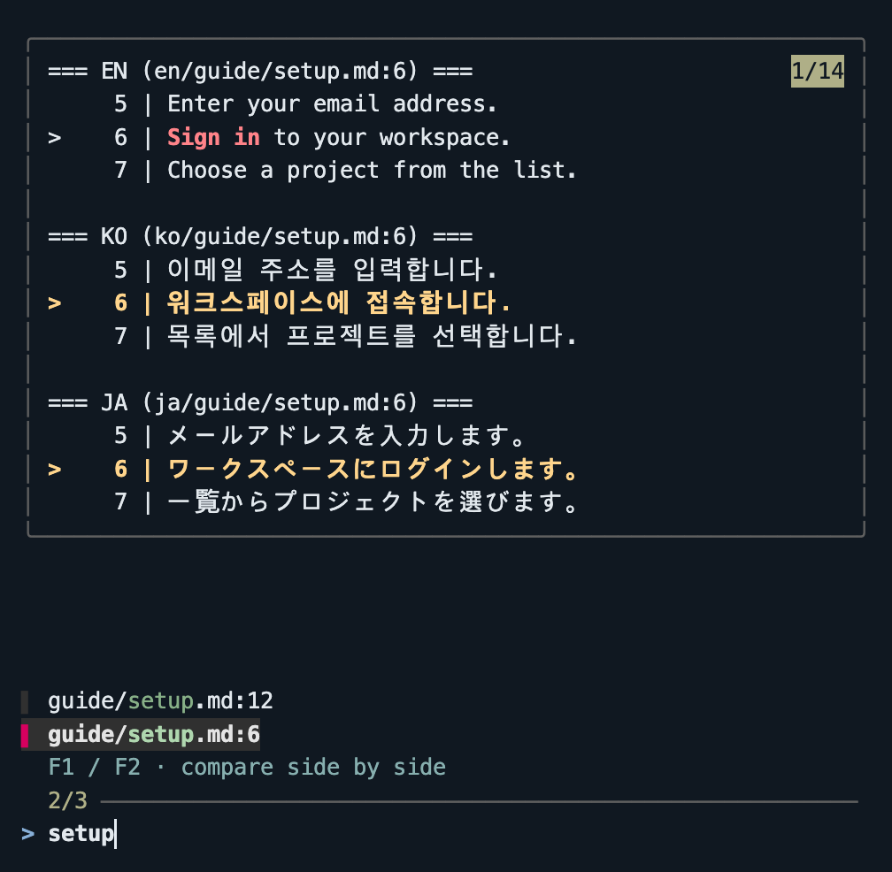
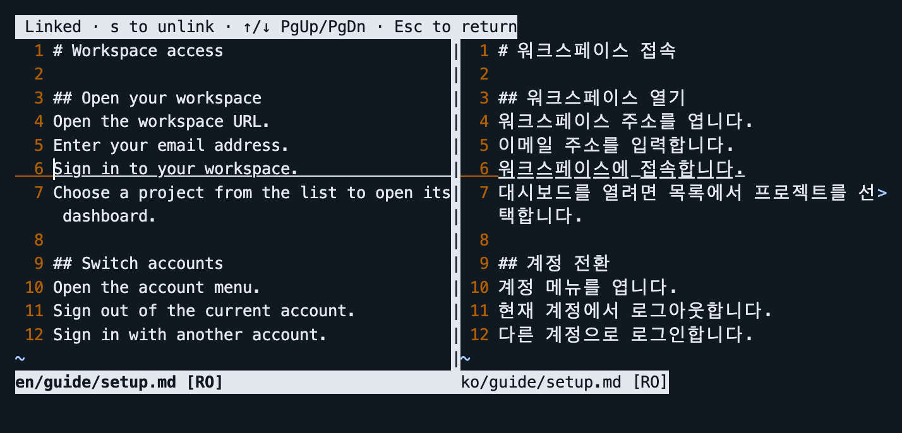
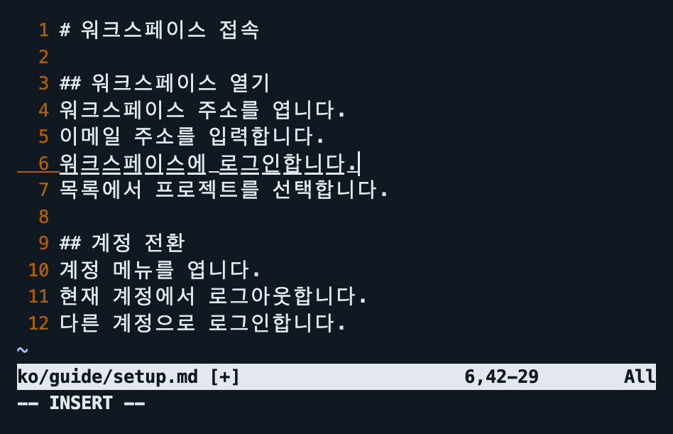

# tgrep

[English](README.md) · [한국어](README.kr.md) · 日本語

`tgrep` は、`grep` で原文ファイルを検索し、[fzf](https://github.com/junegunn/fzf) で結果を一覧できるツールです。検索結果にカーソルを合わせると、原文と各翻訳の該当行を前後の行とあわせて確認できます。
[Kubernetes のドキュメント](https://github.com/kubernetes/website)を翻訳しているときに、同じ用語がほかのページでどう訳されているかをまとめて調べるために作りました。

[検索から翻訳ファイルを開くまでの GIF を見る](assets/tgrep-demo.gif)

## 必要なツール

次のコマンドを `PATH` の通ったディレクトリに用意してください。

- `zsh` はスクリプトを実行します。
- `grep`は原文ファイルを検索します。
- `fzf` 0.60.0 以降は検索結果を選択し、プレビューを確認するための画面を表示します。
- `awk` はプレビューに表示する行を抽出します。

`PATH` 上に `vim` がある場合のみ、左右比較のショートカット `F1`・`F2` が有効になります。

## インストール

リポジトリをクローンしたディレクトリで次のコマンドを実行します。

```sh
mkdir -p "$HOME/.local/bin"
install -m 755 tgrep "$HOME/.local/bin/tgrep"
```

必要に応じて `$HOME/.local/bin` を `PATH` に追加してください。クローンしたディレクトリから `./tgrep` を直接実行することもできます。

## 検索する

各言語のディレクトリに同じ相対パスで文書を置きます。たとえば、原文が `en/guide/setup.md` なら、翻訳は `ko/guide/setup.md` や `ja/guide/setup.md` に置きます。

```sh
cd docs
tgrep 'sign in'
```

上下キーで結果を選ぶと、上部に原文と各翻訳の同じ行が表示されます。`setup` などパスの一部や行番号を入力すると、結果を絞り込めます。`Esc` で検索を終了します。



検索語には大文字と小文字を区別しない拡張正規表現を使えます。翻訳が一つ以上ある原文が検索対象です。隠しパスと Git の除外規則に該当する未追跡ファイルはスキップします。

バッククォート 3 個以上で囲んだコードブロックは検索対象から除外します。ブロック以降の本文は元の行番号で表示されます。

## 左右に並べて比較する

検索結果で **`F1`** を押すと、左に原文、右に最初の翻訳が開きます。**`F2`** は 2 番目の翻訳を開きます。たとえば `TGREP_TARGET_LANGS=ko,ja` なら `F1` は韓国語、`F2` は日本語です。この操作には `PATH` 上の `vim` が必要です。



- 最初は両方のペインが連動します。長い行は各ペインの幅で折り返され、上下キーで画面上の 1 行ずつ、Page Up・Page Down で 1 ページずつ移動できます。
- 別々に読みたいときは `s` を押し、左キーで原文、右キーで翻訳を選んでスクロールします。もう一度 `s` を押すと、選択中のペインの位置から連動を再開します。
- `Esc` で元の検索結果に戻ります。

連動中は両方のペインが行番号で揃います。翻訳で行を追加・削除した場合は、対応する文の位置がずれることがあります。

## 翻訳を直接編集する

検索結果で **`Enter`** を押すと、`TGREP_TARGET_LANGS` の順で最初に見つかった翻訳が `$EDITOR`（既定は `vi`）で開きます。下の例では、英語の原文で見つけた 6 行目の韓国語訳を Vim で編集しています。



vi、Vim、Neovim、nano、Emacs、VS Code では選択した行に移動します。それ以外のエディターにはファイルのパスを渡します。

## 設定

`~/.config/tgrep/config` に既定値を設定できます。zsh がこのファイルを読み込んで実行するので、シェルと同じように引用符や `$HOME` などの変数を使えます。

```sh
TGREP_DOCS_DIR="$HOME/kubernetes/website/content"
TGREP_ORIGIN_LANG=en
TGREP_TARGET_LANGS=ko,ja
TGREP_ENTER_ACTION=edit
```

| 設定項目 | 既定値 | 説明 |
| --- | --- | --- |
| `TGREP_DOCS_DIR` | `.` | 言語別ディレクトリを格納する親ディレクトリ。相対パスは現在の作業ディレクトリを基準に解決されます。 |
| `TGREP_ORIGIN_LANG` | `en` | 検索対象となる原文の言語ディレクトリ。 |
| `TGREP_TARGET_LANGS` | `ko,ja` | プレビューする翻訳の言語ディレクトリ。複数指定する場合はコンマで区切ります。 |
| `TGREP_ENTER_ACTION` | `edit` | Enter キーの動作。`edit` は最初に見つかった翻訳ファイルを `$EDITOR`（既定は `vi`）で開きます。`print` は原文のパス、行番号、一致した行の内容を出力します。 |
| `TGREP_BEFORE_LINES` | `3` | 該当行の前に表示する行数（0 以上）。 |
| `TGREP_AFTER_LINES` | `3` | 該当行の後に表示する行数（0 以上）。 |
| `TGREP_BEFORE_LINES_{LANGCODE}` | `TGREP_BEFORE_LINES` の値 | 言語別の前の行数。たとえば `pt-BR` では `TGREP_BEFORE_LINES_PT_BR=1` で前の 1 行を表示します。 |
| `TGREP_AFTER_LINES_{LANGCODE}` | `TGREP_AFTER_LINES` の値 | 言語別に後ろの行数を指定します。例：`TGREP_AFTER_LINES_KO=5` で韓国語の後ろ 5 行を表示。 |

環境変数に空でない値を指定すると、その実行時は設定ファイルの値よりも優先されます。たとえば、親ディレクトリと原文の言語には設定ファイルの値を使い、日本語訳だけを表示するには、次のように実行します。

```sh
TGREP_TARGET_LANGS=ja tgrep 'sign in'
```

## ライセンス

[MIT ライセンス](LICENSE)
