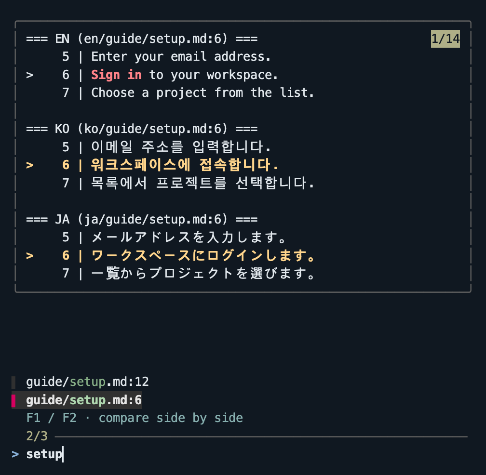
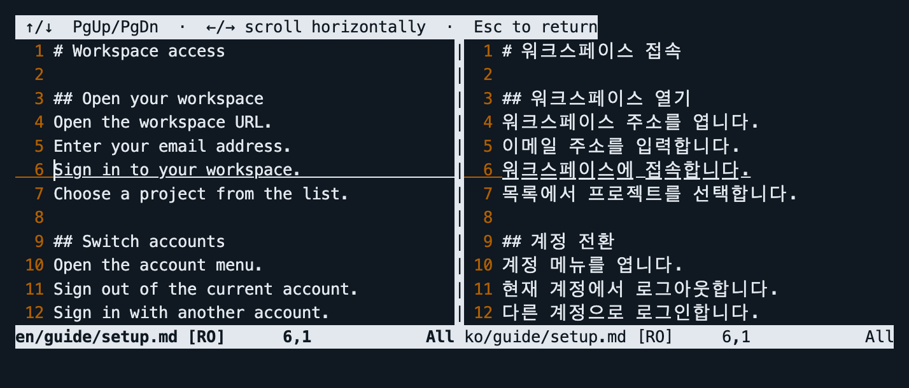
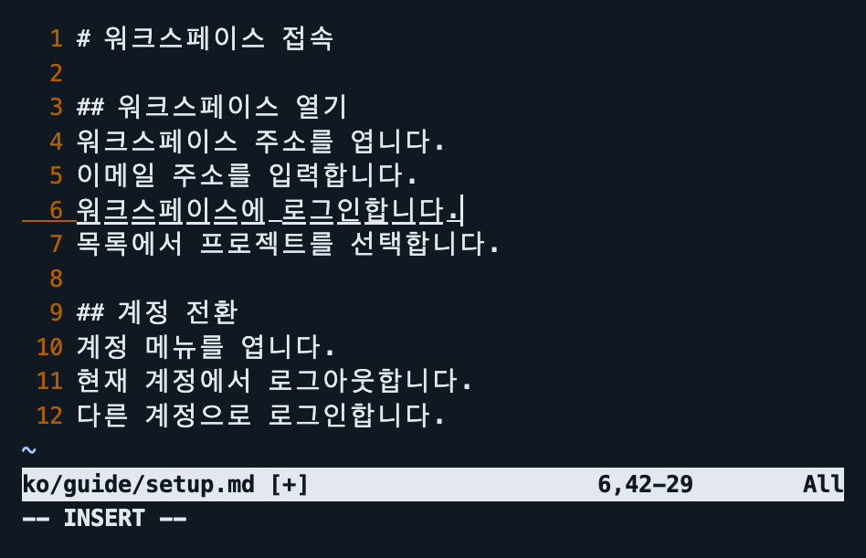

# tgrep

English · [한국어](README.kr.md) · [日本語](README.jp.md)

`tgrep` searches source-language files with `grep` and lets you browse the matches in [fzf](https://github.com/junegunn/fzf). Highlight a match to see the source line and the surrounding lines in each available translation.
I built `tgrep` while translating the [Kubernetes documentation](https://github.com/kubernetes/website) so I could look up translations of the same term across multiple pages at once.

[Watch the search-to-editor demo (GIF)](assets/tgrep-demo.gif)

## Dependencies

The following commands must be on your `PATH`.

- `zsh` runs the script.
- `grep` searches the source files.
- `fzf` 0.60.0 or later displays the interactive results and preview.
- `awk` extracts the lines shown in the preview.

The optional `F1` and `F2` comparison shortcuts are enabled when `vim` is on your `PATH`.

## Install

Run these commands from a clone of this repository.

```sh
mkdir -p "$HOME/.local/bin"
install -m 755 tgrep "$HOME/.local/bin/tgrep"
```

Add `$HOME/.local/bin` to your `PATH` if needed. You can also run `./tgrep` directly from the clone.

## Search

Keep the same document path in each language directory. For example, the translations of `en/guide/setup.md` go in `ko/guide/setup.md` and `ja/guide/setup.md`.

```sh
cd docs
tgrep 'sign in'
```

Use Up and Down to select a result. The preview shows that line in the source and each available translation. Type part of a path, such as `setup`, or a line number to narrow the list. Press `Esc` to quit.



Search patterns are case-insensitive extended regular expressions. Only source files with at least one translation are searched. Hidden paths and untracked files covered by Git ignore rules are skipped.

## Compare side by side

Press **`F1`** on a result to open the source on the left and the first target language on the right. **`F2`** opens the second target language. With `TGREP_TARGET_LANGS=ko,ja`, `F1` opens Korean and `F2` opens Japanese. These shortcuts require `vim` on your `PATH`.



- Scroll both panes with Up, Down, Page Up or Page Down. Use Left and Right to read long lines.
- Press `Esc` to return to the same search result.

The panes align by line number. Adding or removing lines in a translation can put corresponding passages on different rows.

## Edit a translation

Press **`Enter`** on a search result to open the first available translation in `TGREP_TARGET_LANGS` order. It opens in `$EDITOR`, which defaults to `vi`. Here the English match is on line 6, and the Korean translation is being edited on that line in Vim.



vi, Vim, Neovim, nano, Emacs and VS Code jump to the selected line. Other editors receive the file path.

## Configuration

Create `~/.config/tgrep/config` to set your defaults. The file is sourced by zsh, so shell quoting and `$HOME` expansion work:

```sh
TGREP_DOCS_DIR="$HOME/kubernetes/website/content"
TGREP_ORIGIN_LANG=en
TGREP_TARGET_LANGS=ko,ja
TGREP_ENTER_ACTION=edit
```

| Setting | Default | Meaning |
| --- | --- | --- |
| `TGREP_DOCS_DIR` | `.` | Directory containing the language directories. Relative paths start at the current working directory. |
| `TGREP_ORIGIN_LANG` | `en` | Source-language directory to search. |
| `TGREP_TARGET_LANGS` | `ko,ja` | Comma-separated target-language directories to preview. |
| `TGREP_ENTER_ACTION` | `edit` | Enter action. `edit` opens the first available translation in `$EDITOR` (default: `vi`). `print` outputs the source path, line number, and matching text. |
| `TGREP_BEFORE_LINES` | `3` | Number of lines before the match (0 or more). |
| `TGREP_AFTER_LINES` | `3` | Number of lines after the match (0 or more). |
| `TGREP_BEFORE_LINES_{LANGCODE}` | Value of `TGREP_BEFORE_LINES` | Leading context by language. For example, `TGREP_BEFORE_LINES_PT_BR=1` shows one preceding line for `pt-BR`. |
| `TGREP_AFTER_LINES_{LANGCODE}` | Value of `TGREP_AFTER_LINES` | Trailing context for one language. For example, `TGREP_AFTER_LINES_KO=5` shows five following lines in Korean. |

A nonempty environment variable overrides the corresponding file setting for that invocation. For example, to preview only Japanese with the root and source language from your config:

```sh
TGREP_TARGET_LANGS=ja tgrep 'sign in'
```

## License

[MIT License](LICENSE)
